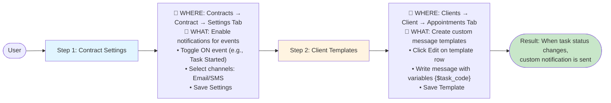

# Task Notification System - Quick Reference

## Process Flow



## Two-Step Configuration

### Step 1: Enable Notifications (Contract Level)
**Navigate:** `Contracts → [Select Contract] → Settings Tab → Notification Settings`

**Actions:**
- Toggle ON the event you want (e.g., "Task Started")
- Select at least one channel: Email or SMS
- Click "Save Settings"

**Result:** Notifications are enabled for this contract

---

### Step 2: Customize Templates (Client Level)
**Navigate:** `Clients → [Select Client] → Appointments Tab → Task Notification Templates`

**Actions:**
- Find the template row (Event + Channel)
- Click "Edit" button
- Write custom message using variables like `{$task_code}`, `{$engineer_name}`
- Click "Save Template"

**Result:** Custom template is saved and will be used for notifications

---

## Example: Enable "Task Started" Email Notifications

**Step 1 - Contract Settings:**
```
✅ Enable "Task Started" toggle
✅ Enable "Email" channel
💾 Save Settings
```

**Step 2 - Client Templates:**
```
📝 Edit "Task Started" + "Email" template
✏️ Subject: "Task Started - {$task_code}"
✏️ Body: "Hello {$resident_name}, task {$task_code} has started."
💾 Save Template
```

**Outcome:** When a task starts, an email is sent with your custom message.

---

## Available Events
- Task Started
- On Route  
- Task Complete
- No Access
- Appointment Confirmed
- Appointment Reminder

## Available Channels
- Email (with HTML template)
- SMS (plain text)

## Common Variables
`{$task_code}`, `{$job_number}`, `{$engineer_name}`, `{$resident_name}`, `{$property_address}`, `{$appointment_date}`, `{$appointment_time}`

---

## Edge Cases

**❌ Event enabled but no channels selected**
→ Error: Must enable at least one channel

**❌ Invalid variable format `{task_code}`**
→ Auto-corrected to `{$task_code}`

**✅ Custom template deleted**
→ System uses default template automatically
